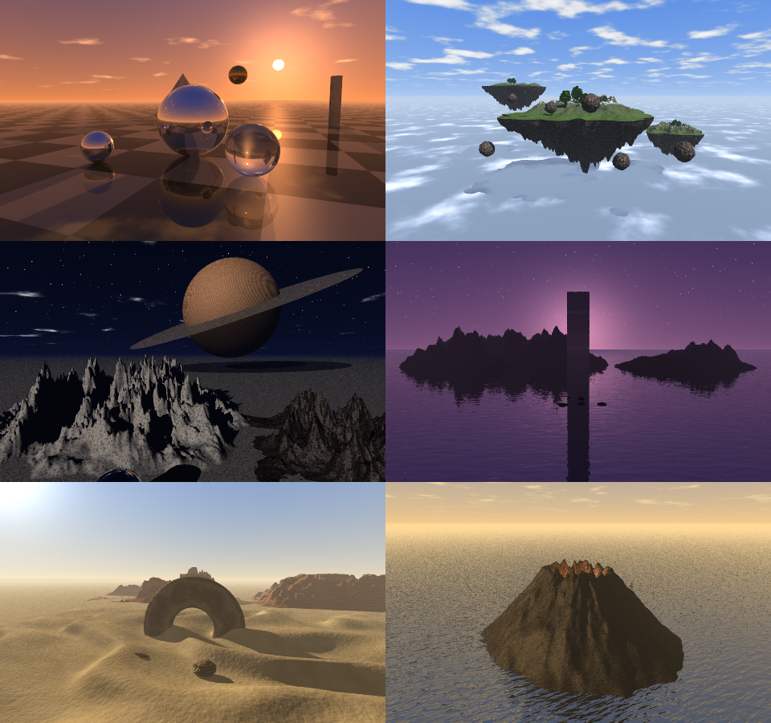

# Two Hoodoos and a Floppy

A native Windows landscape studio for sculpting terrain, staging little worlds, and software ray tracing. For anyone who remembers when a chrome sphere over a checkerboard was a perfectly good evening.



## Get started

Install Visual Studio 2019 or later with the **Desktop development with C++** workload, or the equivalent C++ Build Tools. From the repository root in PowerShell, run:

```powershell
.\build.bat
.\build\Canyon3D.exe
```

Close the studio before rebuilding so the linker can replace `Canyon3D.exe`. The app uses C++17, Win32 and GDI, with no third-party dependencies.

1. Open **Examples** to load a complete scene, or use **Create** to start placing objects.
2. Use **Edit** to move, rotate, resize, or sculpt. Open **Materials Lab** and **Sky & Fog** to set the look of the scene.
3. Press **Ctrl+R** to render. Use **Save Image** to write a BMP, or **Ctrl+S** to save an editable `.c3d` scene.

## What you can make

- Sculpt heightfields and symmetric lattices with brushes, procedural generators, erosion, terraces, and BMP heightmaps.
- Fuse positive metaballs and carve the shared surface with subtractive balls or Boolean primitives.
- Add BMP picture cards with chroma cutouts. Use fixed planes or cards that face the camera.
- Combine primitives with Boolean operations, generate trees, and import Wavefront OBJ meshes.
- Layer procedural and BMP textures across material channels, and save individual texture layers as `.c3tex` presets.
- Place point, spot, and directional lights, and tune fog, clouds, sunlight, and moonlight.
- Keyframe object transforms, the camera, and the sky. Render a still, a panorama, or an animation as numbered BMP frames.

## Render from the command line

```powershell
.\build\Canyon3D.exe --render out.bmp 640 400
.\build\Canyon3D.exe --render out.bmp 640 400 scene.c3d
.\build\Canyon3D.exe --example 0 example.bmp 640 400
.\build\Canyon3D.exe --export-example 0 example.c3d
```

`--render` opens the default scene when no scene file is supplied. Example indices start at zero. Use paths without spaces with the current command-line parser.

## Useful keys

| Key | Action |
| --- | --- |
| `1`–`4` | Switch between perspective, top, front, and side views |
| `A` / `M` / `E` | Open attributes, materials, or the selected object's editor |
| `F` | Frame the selection or the whole scene |
| `Ctrl+G` / `Ctrl+U` | Group / ungroup the selection |
| `Ctrl+D` / `Delete` | Duplicate / delete the selection |
| `Ctrl+Z` / `Ctrl+Y` | Undo / redo |
| `Ctrl+K` / `Space` | Add a keyframe / play or pause the timeline |
| `[` / `]` | Decrease / increase the terrain brush size |
| `Esc` | Close the active lab or stop a render |

Select an object to reveal its viewport handles. Drag **Move**, **Rotate**, or **Scale** to transform it. Use **E** to shape stones and tori, edit imported meshes and picture cards, or tune lights and metaballs. To fuse metaballs, position them so their fields overlap, select both, and press **Ctrl+G**.

## Source and checks

`src/main.cpp` contains the desktop editor. `src/scene.*` handles objects, intersections, animation, and persistence. `src/render.*` is the ray tracer. Terrain, meshes, and BMP loading live in `src/terrain.*`, `src/mesh.*`, and `src/image.*`.

After a build, run `build\t\buildtest.bat` and then `build\t\test.exe` from the repository root. The test program covers scene round trips, legacy scenes, animation, and terrain tools, and writes render samples under `build\t\`.

See [the backlog](todo.md) and [the implementation log](CHANGELOG.md) for project status.
